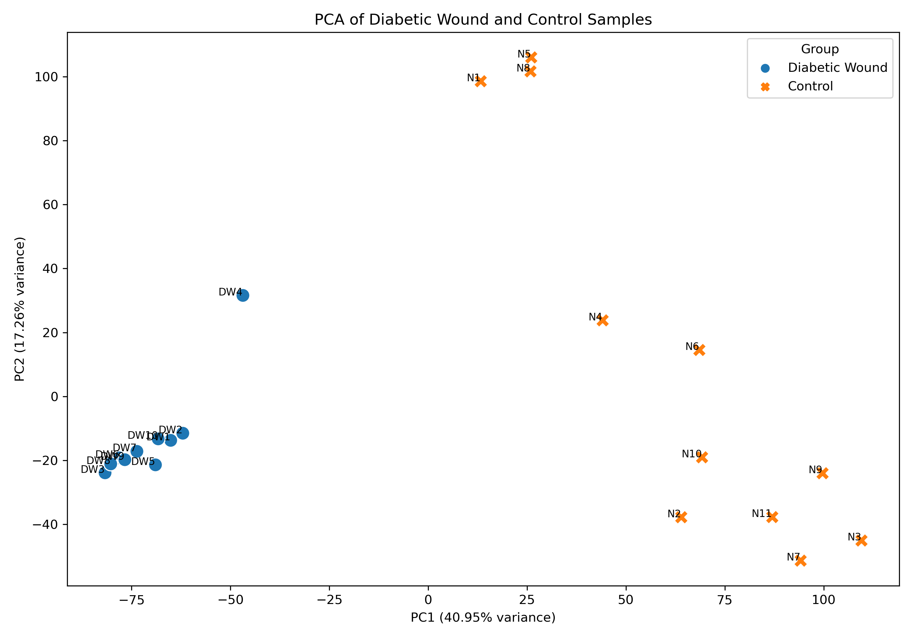
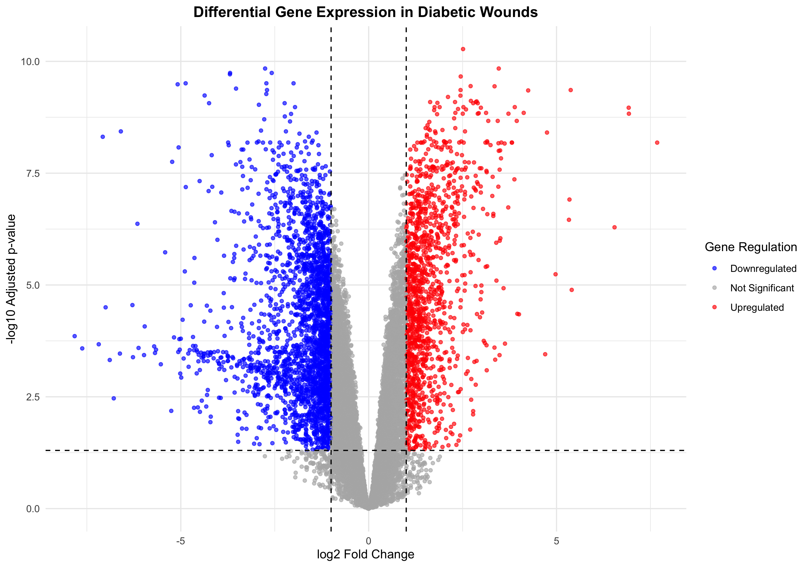
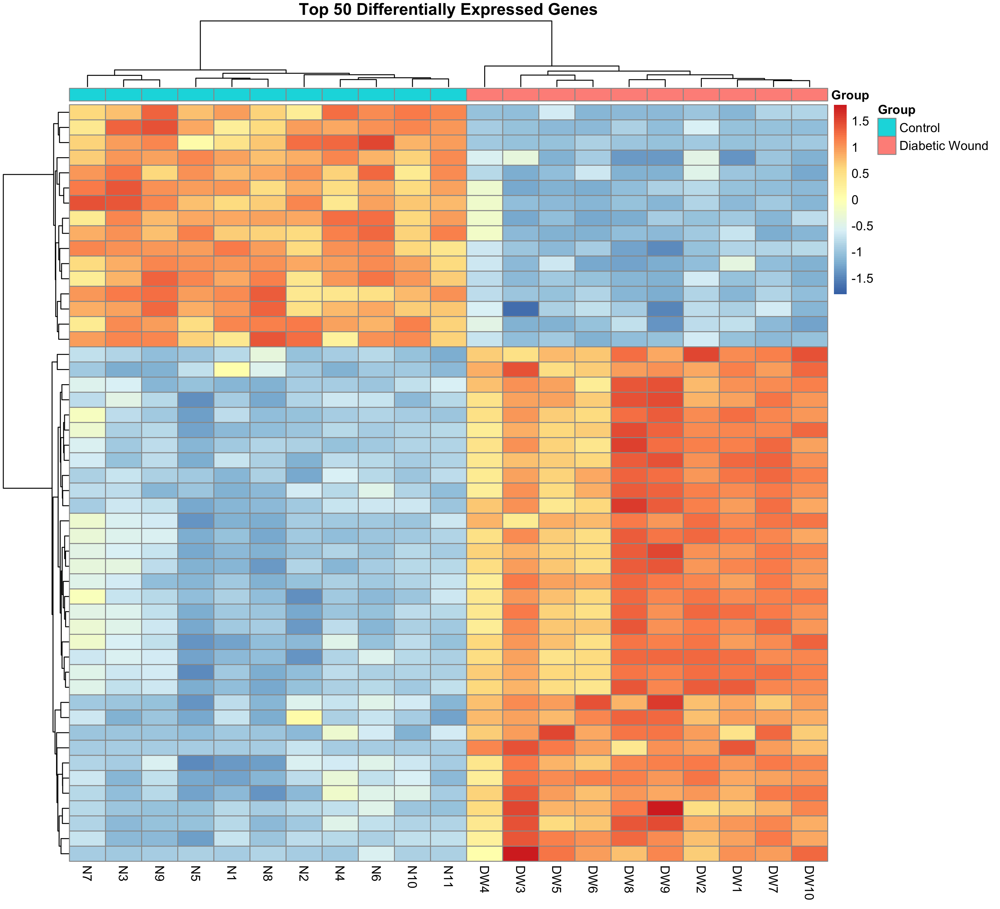
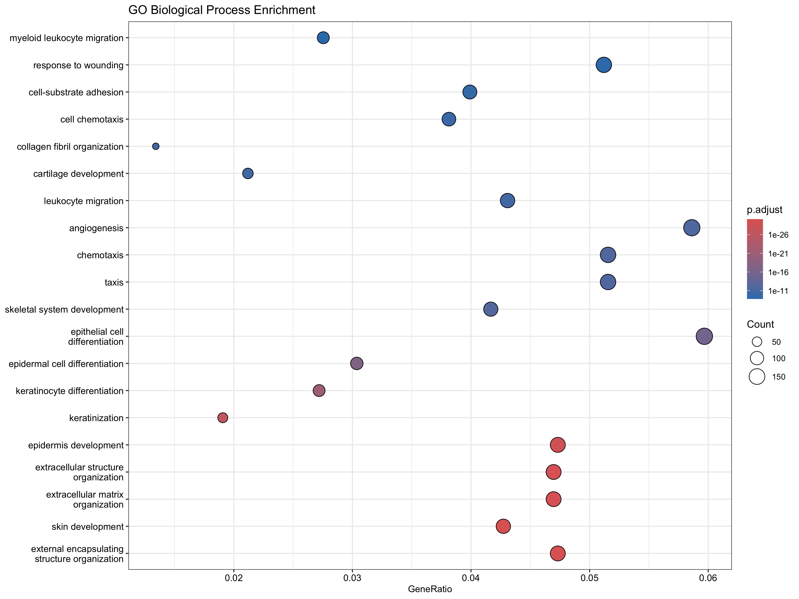
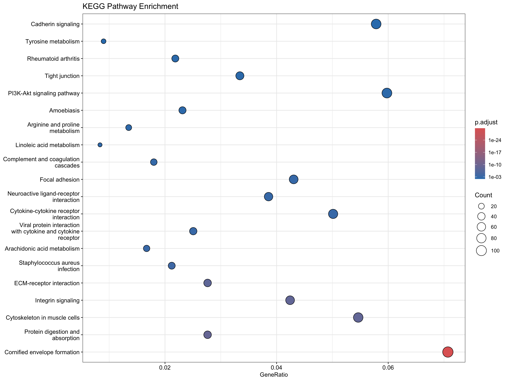

# Diabetic Wound Bioinformatics: Transcriptomic Analysis of Impaired Wound Healing

## Project Overview

Diabetic foot ulcers (DFUs) are a major complication of diabetes and are characterized by impaired wound healing, persistent inflammation, extracellular matrix (ECM) alterations, and defects in tissue repair.

This project investigates gene-expression differences between diabetic wound samples and control samples using publicly available transcriptomic data from the NCBI Gene Expression Omnibus (GEO).

The objective is to identify differentially expressed genes, explore enriched biological processes and pathways, and investigate candidate genes associated with diabetic wound biology.

## Research Objectives

- Perform exploratory analysis of diabetic wound gene-expression data.
- Identify differentially expressed genes (DEGs) between diabetic wound and control samples.
- Investigate enriched Gene Ontology (GO) biological processes and KEGG pathways.
- Visualize gene-expression patterns and sample-level differences.
- Explore candidate genes potentially associated with inflammation, angiogenesis, ECM remodelling, and epidermal repair.

## Dataset

| Attribute | Details |
|---|---|
| Source | NCBI Gene Expression Omnibus |
| GEO accession | GSE199939 |
| Original file | GSE199939_gene.tpm.matrix.annot_-_21.txt.gz |
| Expression measure | Transcripts Per Million (TPM) |
| Original genes/features | 61,343 |
| Total samples | 21 |
| Diabetic wound samples | 10 |
| Control samples | 11 |

**Dataset source:** https://www.ncbi.nlm.nih.gov/geo/query/acc.cgi?acc=GSE199939

The expression matrix was downloaded directly from NCBI GEO. Raw data are not included in this repository; users should obtain the original file from GEO and place it in `data/raw/GSE199939/`.

## Methodology and Workflow

### 1. Dataset Acquisition and Inspection
- Downloaded the expression matrix from NCBI GEO.
- Examined dataset dimensions, sample identifiers, gene annotations, and missing values.
- Checked gene identifier uniqueness and expression-data quality.

### 2. Exploratory Data Analysis
- Examined expression distributions and zero-expression values.
- Applied a filtering criterion of TPM > 1 in at least three samples.
- Used log2(TPM + 1) for visualization and downstream analysis.
- Performed Principal Component Analysis (PCA) to investigate sample-level expression patterns.

### 3. Differential Expression Analysis
- Used the `limma` R package.
- Compared diabetic wound samples against controls.
- Applied Benjamini-Hochberg correction for multiple testing.
- Significance criteria:
  - Adjusted p-value (FDR) < 0.05
  - Absolute log fold change > 1

The analysis was performed on log2-transformed TPM values rather than raw RNA-seq counts. Therefore, the differential expression results should be interpreted as exploratory.

### 4. Functional Enrichment Analysis
- Mapped Ensembl identifiers to Entrez Gene identifiers.
- Performed Gene Ontology Biological Process over-representation analysis using `clusterProfiler`.
- Performed KEGG pathway enrichment analysis.
- Conducted separate analyses for upregulated and downregulated genes.
- Used adjusted p-value < 0.05 as the enrichment significance criterion.

### 5. Visualization and Interpretation
Generated visualizations including:
- Expression distribution plots
- PCA plots
- Volcano plots
- Top-50 DEG heatmaps
- GO enrichment dot plots
- KEGG enrichment dot plots

## Key Results

### Differential Expression

After filtering, 20,187 genes were retained for differential expression analysis.

| Result | Number |
|---|---:|
| Significant DEGs | 3,880 |
| Upregulated genes | 1,326 |
| Downregulated genes | 2,554 |

### Functional Enrichment

**GO Biological Process**
- Combined DEGs: 553 enriched terms.
- Upregulated genes: 819 enriched terms.
- Downregulated genes: 142 enriched terms.

**KEGG**
- Combined DEGs: 26 enriched pathways.
- Upregulated genes: 35 enriched pathways.
- Downregulated genes: 32 enriched pathways.

### Major Biological Findings

Three major biological themes emerged:

1. **Inflammatory and immune response:** Upregulated genes were enriched in processes such as leukocyte migration, chemotaxis, phagocytosis, and cytokine-associated signalling.

2. **Extracellular matrix remodelling and angiogenesis:** Enrichment was observed in ECM organization, integrin signalling, ECM–receptor interaction, and angiogenesis-associated biological processes.

3. **Epidermal differentiation and skin-barrier formation:** Downregulated genes were enriched in epidermis development, keratinization, keratinocyte differentiation, and cornified envelope formation.

Together, these findings suggest altered inflammatory, vascular, tissue-remodelling, and epidermal-associated gene-expression patterns in diabetic wound samples.

## Visual Results

### 1. Principal Component Analysis (PCA)

PCA shows separation between diabetic wound and control samples, with PC1 explaining 40.95% of the variance and PC2 explaining 17.26%.



### 2. Differential Expression Analysis

The volcano plot highlights significantly upregulated and downregulated genes using FDR < 0.05 and |logFC| > 1.



### 3. Heatmap of Top 50 Differentially Expressed Genes

The heatmap displays relative expression patterns of the top 50 differentially expressed genes across all samples.



### 4. Gene Ontology Enrichment

GO Biological Process enrichment highlights biological processes associated with diabetic wound samples.



### 5. KEGG Pathway Enrichment

KEGG enrichment identifies pathways associated with differences between diabetic wound and control samples.



## Candidate Genes

Selected genes for further biological investigation include:

| Direction | Gene | Potential biological relevance |
|---|---|---|
| Upregulated | AURKA | Cell-cycle regulation and proliferation |
| Upregulated | APLN | Vascular and angiogenesis-associated signalling |
| Upregulated | COL10A1 | Extracellular matrix and collagen |
| Upregulated | MYBL2 | Transcriptional regulation and cell proliferation |
| Downregulated | TNXB | Extracellular matrix organization |
| Downregulated | PPL | Epithelial structural organization |
| Downregulated | VIPR1 | Neuropeptide signalling |

These genes are exploratory candidates and require independent validation.

## Repository Structure

```text
diabetic-wound-bioinformatics/
│
├── data/
│   └── raw/
│       └── GSE199939/
│
├── notebooks/
│   ├── 01_dataset_download.R
│   ├── 02_differential_expression.R
│   ├── 03_functional_enrichment.R
│   └── 04_visualization.R
│
├── scripts/
│   ├── 02_exploratory_analysis.py
│   └── 04_generate_week4_report.R
│
├── results/
│   ├── plots/
│   └── tables/
│
├── reports/
│   ├── dataset_inspection.txt
│   ├── week2_eda_observations.txt
│   ├── week2_differential_expression_summary.txt
│   ├── week3_functional_enrichment_summary.txt
│   └── week4_visualization_summary.txt
│
├── docs/
├── .gitignore
└── diabetic-wound-bioinformatics.Rproj
```

## Tools and Technologies

- **R:** Differential expression and functional enrichment analysis.
- **Python:** Exploratory data analysis and PCA.
- **limma:** Linear modelling and differential expression.
- **clusterProfiler:** GO and KEGG enrichment.
- **org.Hs.eg.db:** Human gene annotation.
- **pandas, NumPy:** Data processing.
- **Matplotlib, Seaborn:** Data visualization.
- **scikit-learn:** Principal Component Analysis.
- **Git and GitHub:** Version control and project sharing.

## Limitations

- The analysis used TPM expression values rather than raw RNA-seq counts.
- limma was applied to log2(TPM + 1) transformed expression values; this is not equivalent to a count-aware RNA-seq workflow.
- Potential batch effects and other confounding variables have not been fully assessed.
- Gene identifier mapping and annotation coverage may influence enrichment results.
- Over-representation analysis does not directly establish pathway activation or inhibition.
- Independent validation using additional datasets and experimental approaches such as RT-qPCR is needed.

## Reproducibility

1. Clone this repository.
2. Download the original expression matrix from [NCBI GEO – GSE199939](https://www.ncbi.nlm.nih.gov/geo/query/acc.cgi?acc=GSE199939).
3. Place the downloaded file in `data/raw/GSE199939/`.
4. Install the required R and Python packages.
5. Execute the analysis scripts in the documented workflow order.

The analysis scripts and reports are provided to support reproducibility. Package versions and exact installation instructions can be added as part of the final project setup.

## Future Work

- Validate candidate genes using independent diabetic foot ulcer datasets.
- Compare findings with additional wound-healing transcriptomic datasets.
- Investigate candidate genes using gene-level literature and network analysis.
- Perform count-aware differential expression analysis if raw counts become available.
- Explore experimental validation strategies for selected candidate genes.

## Acknowledgements

This project uses publicly available transcriptomic data from the NCBI Gene Expression Omnibus.

**GEO accession:** GSE199939